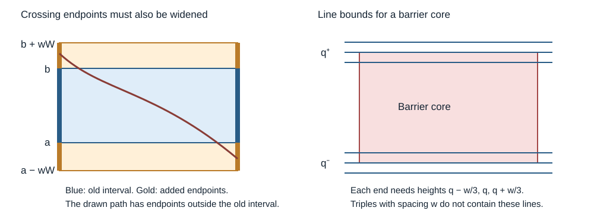

# Errors and proof obligations in the 2026 Basu, Sidoravicius and Sly paper

Let $X$ be the bounded Riemannian passage metric in arXiv:2604.01214v1, dated April 1, 2026, normalized to have time constant one. Write $\mathcal X$ for its conforming distance, $Q_r$ for the regular fluctuation scale, and $W_r=\sqrt{rQ_r}$. A prime denotes the environment obtained by refreshing each enhanced noise block with probability $\kappa$. All page numbers below are printed page numbers. They agree with the PDF page numbers in the supplied 118-page copy.

**Verdict: gap in the printed proof; the main theorem is not refuted.** Several displayed assertions are incorrect, and several applications lack hypotheses supplied by their event definitions. The resampling construction also needs a precise joint state and conditional law. The corrections below repair individual deductions from explicitly stated inputs. They do not constitute an independent certification of the complete corrected paper. In particular, the 2023 inputs have affected proofs of their own.

The principal distinction is between changing a formula and changing an event. The factors in the variance proof, the displaced corridor, and several signs have local corrections. The widening, line conditions, joint conditioning, and noise supports require changes to the construction and corresponding changes to every conditional likely event. Merely replacing a few symbols does not address those gaps.

The source is [BSS26](https://arxiv.org/abs/2604.01214v1). Its SHA-256 is `c56da0e8c115bb56aa01e3b64379cf60f4a0a5c9cb00ae55c433b1aa4f81d516`. The predecessor is [BSS23](https://arxiv.org/abs/2312.14143v1), SHA-256 `9c3b2ef46e5068e75ba7cd026c237035a4c42af7d86b54d23ae9bb35eb59360a`. Mathematical assertions in this report carry one of two labels: proved, for the discrepancy or deduction established here, and conditional, when an identified source estimate remains an input. No numerical experiment is used as proof.

## 1. The dependency of Theorem 1

**Proved dependency audit.** The road map on page 7 is implemented as follows.

| Conclusion | Inputs in the printed proof | Relevant corrections below |
| --- | --- | --- |
| Theorem 1 | Theorem 2.14 and the scale comparisons for $Q$ | Sections 2.1 and 8; the 2023 dependencies in Section 9 |
| Theorem 2.14 | Theorem 2.13 and Lemma 2.8 in $L^2$ | Section 8 |
| Theorem 2.13 | Proposition 2.15, Proposition 2.17, and the martingale calculation on pages 17–19 | Sections 2.3 and 3 |
| Proposition 2.15 | Local rewards in Section 3, Proposition 3.1, and the joining-height estimate in Appendix C.2 | Section 3.2 and the qualifications in Section 10 |
| Proposition 2.17 | Theorem 4.9, Lemma 4.10, the covering argument in Section 5, and occupation estimates | Sections 4–7 |
| Lemma 4.10 | Arrival profiles and the six path types in Section 6 | Sections 4 and 6 |
| Theorem 4.9 | Lemma 7.1 and the selected resampling kernels in Section 8 | Sections 5–7 |
| Elementary events | Section 9, conforming approximation, and the imported 2023 results | Sections 2, 6, 8 and 9 |

**Conditional assessment.** The iteration from Theorem 2.14 to Theorem 1 is valid if its inputs hold with fixed constants. Fix $M$, take a sufficiently large initial scale, and iterate the factor $3M/5$. Comparability of $Q$ with standard deviation fills the gaps between the geometric scales. Every exponent strictly smaller than $\log(5/3)/\log M$ then absorbs the multiplicative constant. The iteration is not the obstruction.

## 2. The imported estimates and their statements

### 2.1. Theorem 2.1 strengthens its cited scale comparison

**Proved citation discrepancy; not a counterexample to a scale theorem.** Page 8 prints

$$
Q_{n'}\le (n'/n)^{1/2+\delta}Q_n
$$

for every sufficiently large pair $n'\gt n$. BSS23 Lemma 7.3, page 43, instead states $Q_{n'}\le D_5(n'/n)^{3/4}Q_n$. Its comment after the proof allows an exponent above $1/2$, with a multiplicative constant. A constant cannot be absorbed into a larger exponent uniformly as $n'/n\downarrow1$.

**Conditional replacement.** Retain

$$
Q_{n'}\le C_\delta(n'/n)^{1/2+\delta}Q_n.
$$

For the fixed, sufficiently large scale ratios used in the construction, $C_\delta$ can be absorbed by slightly increasing the exponent. The later square-root comparison follows instead from Corollary 2.16 and the two variance comparisons. This correction affects the deductions of (3), the elementary-event tails, the growth bound used on page 69, and the appendices. No argument here establishes the constant-one assertion for every nearby pair of scales. The lower comparison also retains the positive base-scale constant when it is derived from the original definition of $Q$.

**Proved model qualification.** The model on page 3 permits $K\equiv0$. Then $X_n=\psi(0)n$ is deterministic and Theorem 1 is true, but Theorem 2.1's claims $Q_n\asymp\sqrt{\mathop{\mathrm{Var}}X_n}$ and $Q_n\ge n^{\alpha_*}>0$ cannot both hold. The invocation of nondegenerate 2023 inputs needs a separate trivial deterministic case or an explicit nondegeneracy assumption. This does not contradict the variance upper bound.

### 2.2. Lemma 2.5 has a reversed event and an undefined logarithm

**Proved errors.** Page 10, equation (4), prints

$$
\mathbb P\left[\inf_{\gamma'\in\Xi^{(n),R}_{x,x',y,k,z}}
(X_{\gamma'}-X_{\gamma'(0),\gamma'(1)})
\ge z^{1/3}Q_n/4000\right]\le e^{1-Dz^{\theta_0}},
\qquad k\le\lfloor\log_2(x-x')-1\rfloor.
$$

The definition requires $x\lt x'$, so the logarithm is not real. Replace it by $\log_2(x'-x)$. With that change made, the displayed probability has the wrong direction: the preceding 2023 lemmas establish that the excess is large with high probability. This is also visible without a probabilistic theorem. Fix the endpoints' bounded windows and a permissible $k$. As $z\to\infty$, every path in this class must reach a height growing linearly in $z$. The lower density bound makes its cost at least $c zW_n-C$, whereas the unrestricted endpoint distance has a deterministic upper bound independent of $z$. Thus the printed event eventually has probability one, while its asserted upper bound tends to zero.

**Conditional replacement.** Subject to a correct version of BSS23 Lemmas 8.1–8.2, the bad event is

$$
\mathbb P\left[\inf_{\gamma'\in\Xi^{(n),R}_{x,x',y,k,z}}
(X_{\gamma'}-X_{\gamma'(0),\gamma'(1)})
\le z^{1/3}Q_n/4000\right]\le e^{1-Dz^{\theta_0}}.
$$

One may decrease the positive gap constant to avoid endpoint equality issues. Both misprints are already present in BSS23 Corollary 8.3, page 51. Appendix B uses the positive-gap content of the earlier lemmas rather than the literal reversed corollary. Its local estimates and the geometric inputs depending on them need the corrected form. The additional problems in those earlier proofs are discussed in Section 9.

### 2.3. A maximum lower-tail estimate does not control an endpoint minimum

**Proved mismatch.** Proposition 2.9(ii), page 12, prints a maximum in

$$
\mathbb P\left(\max_{u,v}(\mathcal X_{uv}-|u-v|)\le-zQ_r\right)
\le e^{1-Cz^{\theta_2}}.
$$

This is not a false consequence of a stronger estimate. It is too weak for the uses requiring that every endpoint pair has a lower bound. For example, two numbers $-2zQ_r$ and $0$ have maximum above $-zQ_r$ but minimum below it.

**Conditional replacement with proof.** Replace the maximum by a minimum. The uniform absolute-deviation estimate for the original distance, Proposition 2.2, gives the lower bound for every pair in a canonical window. Lemma 2.8's second assertion gives $\mathcal X_{uv}\ge X_{uv}-o(Q_n)$ uniformly, including the larger endpoint range. A union bound and a small weakening of the exponent give the required uniform lower tail up to a polynomial cutoff. Beyond that cutoff, deterministic bounds and a further weakening of the tail exponent suffice. Reflections and covering by canonical windows supply the endpoint conventions. This is the form required by the full-column lower events in Sections 4 and 9 and by the lower rewards in Appendix C.2. The same maximum/minimum problem recurs on pages 94–95; see Section 6.3.

## 3. The variance calculation and the first estimate of Proposition 2.15

### 3.1. The factor on page 18 is wrong, but a sharper argument repairs it

**Proved errors.** After defining $H^{ij}$ and $G^{ij}$ on page 17, page 18 prints

$$
\mathbb E(G^{ij}(t))^2\ge2\mathbb E(H^{ij}(t))^2.
$$

The preceding calculation gives only $\mathbb E H^2\le2\mathbb E G^2$. The printed stronger assertion is not a general martingale fact. For a single Bernoulli coordinate $A$ and independent replacement $B$, both with parameter $1/2$, take the functional to be $A$. A forced reveal gives $H=A-1/2$ and $G=(B-A)_+$. Both second moments equal $1/4$.

Equation (11) then uses coefficient two, while equation (14) drops that coefficient in the early, middle and far contributions. Equations (9), (11), (12) and (13) as printed do not imply (14).

**Proved replacement.** Set $G^+=\mathbb E[D_+\mid\mathcal F_t^{+ij}]$ and $G^-=\mathbb E[D_-\mid\mathcal F_t^{+ij}]$, where $D=\mathcal X^{ij}_{Mn}-\mathcal X_{Mn}$. Conditional independence of the two target-block copies gives

$$
\mathbb E(G^+-G^-)^2=2\mathbb EH^2.
$$

Exchangeability gives equal second moments for $G^+$ and $G^-$. Since their product is nonnegative,

$$
2\mathbb EH^2
=2\mathbb E(G^+)^2-2\mathbb E(G^+G^-)
\le2\mathbb E(G^+)^2.
$$

The positive-change support property (6) makes $G^+=G^{ij}$. Therefore the correct useful inequality is $\mathbb EH^2\le\mathbb E(G^{ij})^2$. Replace all leading factors two in (11) by one. The subsequent (14) now follows with its stated $M\mathop{\mathrm{Var}}(\mathcal X_n)/4$ allowance. The conditional Cauchy–Schwarz argument (15), the tail integration (16), and the truncation (17) are then valid from Proposition 2.15. Taking the chaos parameter sufficiently small gives Theorem 2.13. This repairs the variance algebra without a new FPP estimate.

### 3.2. Exchangeability does not preserve the old-path indicator

**Proved error in the deduction.** Section 3.4, page 31, prints

$$
\mathbb E[\mathbf1_{U_{ij}}D^2]
=2\mathbb E[\mathbf1_{U_{ij}}(D_+)^2].
$$

Swapping the old and replacement environments also swaps their visiting events. It does not fix $U_{ij}$. A two-route example shows the distinction. Let one route cost $A\in\{1,3\}$ with equal probabilities, and the other cost $2$. Refresh $A$ independently. The old visiting event is $\{A=1\}$, the passage time is $\min(A,2)$, and the two sides above are $1/4$ and $1/2$.

**Proved replacement.** Since $D_+>0$ requires $U_{ij}$ by (6), exchangeability of $D$ gives

$$
\mathbb E[\mathbf1_{U_{ij}}D^2]
\le\mathbb ED^2
=2\mathbb E(D_+)^2
=2\mathbb E[\mathbf1_{U_{ij}}(D_+)^2].
$$

This inequality suffices for the first estimate of Proposition 2.15 after integrating (25). The example disproves the claimed general exchangeability identity, not the Riemannian moment estimate. The fourth-moment and occupation estimates in Section 3 are not refuted by it.

**Proved scope of the polymer reports.** The previous reports on Proposition 3.1 provide a shorter adjustable quadratic-penalty estimate from BSS23 Proposition 4.1. They do not find a counterexample to Proposition 3.1's $R^{3/4}M$ bound. Its application sites are Lemmas 3.4–3.6, Lemmas 3.9–3.10, and Corollary C.6 followed by Lemma C.7. The replacement also works at these sites, with rewards set to zero outside their stated endpoint range and the original exceptional events retained. Neither that replacement nor the present report independently checks all of Appendix C.1.

## 4. The geometric comparisons

### 4.1. The Type 3 corridor has two incompatible locations

**Proved inconsistency.** Page 35 defines $B^{(4)}$ and $B^{(5)}$ using endpoints $j-\sqrt\alpha$ and $j-\sqrt\alpha+h$. Page 56 defines Type 3 by the interval

$$
[(j-\alpha-w)W_r,(j-\alpha+h+w)W_r].
$$

Page 62 repeats the displacement $-\alpha$, whereas the proof of Lemma 6.8 on pages 60–61 uses $-\sqrt\alpha$. For the prescribed large $\alpha$, these are disjoint corridors. The witness furnished by $B^{(4)}$ is not a Type 3 witness under the literal page 56 definition.

**Proved correction.** Replace $\alpha$ by $\sqrt\alpha$ in the displacement in the Type 3 definition and every matching interval in Lemma 6.9. The cancellation in Lemma 6.8 requires a quadratic approach cost of order $\alpha Q_r$, which is exactly the cost of displacement $\sqrt\alpha W_r$. Displacement $\alpha W_r$ instead costs order $\alpha^2Q_r$. This is a uniquely indicated geometric correction. It propagates through Lemmas 6.8–6.11, Lemma 4.10 and the successful-completion implication (64).

### 4.2. The widening event excludes some Type 3 endpoints

**Proved missing hypothesis.** The definition of $\mathcal M$ on page 33 keeps $y,y'\in[jW_r,j'W_r]$ in both infima. Only the path rectangle is enlarged in the second infimum. A Type 3 path can start and finish anywhere in the enlarged interval. Consequently the lower bound

$$
\mathcal X_{u,u'}\ge r-(\alpha-\alpha^{9/10}+1)Q_r
$$

asserted at the bottom of page 60 does not follow for its endpoints. An infimum over a smaller endpoint set cannot bound costs for points excluded from that set. This is a gap in an application, not a counterexample to the intended separation conclusion.

**Conditional replacement with proof.** Let $U_v$ be the infimum of $\widehat{\mathcal X}^v$ over crossings of $[0,r]\times[a,b]$ with both endpoints in $[a,b]$, for $v$ equal to the old or refreshed field. Let $U_v^+$ allow both the paths and endpoints in $[a-wW_r,b+wW_r]$. Replace $B^{(5)}$ by

$$
B_5^+=\bigcap_v\{U_v-U_v^+\le Q_r\}.
$$

After the centering correction in Section 7.1, choose $h$ to minimize $\mathbb EU(h)+10C_*Q_rh$ on $[1,2]$. The endpoint expectation bounds imply $h<3/2$. Single-field translation invariance and $h+2w\le2$ give

$$
0\le\mathbb E(U_v-U_v^+)
=\mathbb EU(h)-\mathbb EU(h+2w)\le20C_*wQ_r.
$$

Markov's inequality and a two-field union bound give failure at most $40C_*w$. Thus $w\le\delta_A/(4000C_*)$ gives the $\delta_A/100$ budget. After exposure of the narrow core, each event $U_v^+\ge U_v-Q_r$ is increasing in that field's unobserved noise. Its support is the widened noise support already needed in the construction. This replacement must be made in $B$, the conditional likely events, and the selected kernels. It then supplies the lower bound for the cost of every widened Type 3 subpath. The page 60 application should use that subpath cost or its constrained infimum: the unrestricted distance between its endpoints can leave the widened rectangle and is not bounded below by this event. The same distinction applies when Lemma 6.1 is used for an arbitrary Type 4 path. Its path-splitting proof gives a lower bound for the cost of the subpath that meets the core; a lower bound for an unrestricted minimizer that avoids the core is not asserted.

The left drawing includes the endpoint intervals as well as the path rectangle. The right drawing shows the three specified line heights at each end of a barrier core. The figure does not assert that bounds at the outer lines imply bounds at intermediate heights.

### 4.3. The Type 4 application lacks the line triples in Lemma 6.1

**Proved event mismatch.** On page 47, Lemma 6.1 requires $K^*_{i,q,z_2,v}$ at both ends of a barrier core, hence line bounds at $q-v,q,q+v$. The central $B^{(7)}$ on page 36 supplies vertical-change bounds with threshold $wW_r/3$. The page 62 invocation therefore needs triples with spacing $w/3$. The page 35 event $B^{(6)}$ supplies triples with spacing $w$, which does not supply those intermediate lines.

**Conditional replacement with proof.** Put $a/W_r=j-\sqrt\alpha$ and $b=a+hW_r$, or use the rounded $a$ of Section 5.2. Keep all old $B^{(6)}$ factors and add, in both fields, triples $K^*_{i,q,L_1,w/3}$ at the six heights

$$
\begin{aligned}
q_1^-&=j-L_1+w,&q_1^+&=a/W_r-2w/3,\\
q_2^-&=b/W_r+2w/3,&q_2^+&=j-3L_0/2,\\
q_3^-&=j+3L_0/2,&q_3^+&=j+L_1-w.
\end{aligned}
$$

For $wW_r\ge6$, each core enlarged by $w/3$ lies inside its corresponding $B^{(7)}$ rectangle, including the two-unit margins. A connected Type 4 segment meets one of these cores: the complementary components inside the inner $L_1$ band are contained in the central Type 1–2 strip or the widened Type 3 strip. The retained $I^+$ and $J$ estimates restrict to the smaller rectangle. Lemma 6.1 now has the requisite hypotheses.

The old eight centers give at most 48 single-field $K$ events, and the six added centers give 36 more. The page 38 single-line failure bound $\delta_A/(10000L_0)$ therefore gives total failure at most $84\delta_A/(10000L_0)\lt \delta_A/(100L_0)$. The same Markov charge in the likely-event argument suffices. This is an actual strengthening of an event; it is not a consequence of the old event. The separate outer-column invocations of Lemma 6.1 also need their hypotheses checked, rather than being certified by this central-column repair.

### 4.4. The central barrier has quadratic, not cubic, strength

**Proved mismatch.** Page 36 uses $L_2^2$ in all the central $I^+$ and $J$ barriers. Lemma 6.9, page 61, and its proof on page 62 instead assert the penalty $L_2^3Q_r/2$ and begin with $(L_2^3-2L_1)Q_r$. Lemma 6.1 preserves the barrier parameter $z_1$ additively. Substituting $z_1=L_2^2$ cannot produce $L_2^3$.

**Conditional sufficient replacement with proof.** With the additional triples above, the central cost is at least

$$
r+Q_r\left[L_2^2-2L_1+	frac12(x-3L_1)_+^2+	frac12(x'-3L_1)_+^2\right],
$$

where $x=|y/W_r-j|$ and $x'=|y'/W_r-j|$. Using the corrected global profile slope nine from Section 4.5, and $\min_{x\ge0}\{(x-c)_+^2/2-9x\}=-9c-81/2$, gives excess at least

$$
[L_2^2-56L_1-16L_2-81]Q_r\ge L_2^2Q_r/2
$$

if $L_2^2\ge112L_1+32L_2+162$. This is compatible with $L_2=L_1^{100}$. The retained slope-eight profiles would give $L_2^2-50L_1-16L_2-64$ instead, but their printed derivation has the next discrepancy. The quadratic penalty already exceeds the $L_0^2Q_r/50$ threshold used to exclude Type 4 in Lemma 6.11. No proof of the stronger cubic conclusion from the printed central barriers is supplied here.

### 4.5. The optimization yielding the global arrival-profile slope loses one unit

**Proved algebraic gap.** Page 55, equation (53), optimizes the lower bounds from the outer profile and the intermediate column and claims slope eight. In normalized coordinates the expression to minimize, away from the finite outer barrier interval, contains

$$
\tfrac12(x-t)^2-7|t|-|t|-|x|-6L_2-L_0.
$$

For $x>0$ large, $t=x+8$ is beyond that interval and gives $-9x-6L_2-L_0-32$. This is smaller than the claimed $-8x-7L_2$ when $x\gt L_2-L_0-32$. Thus the stated optimization does not give (53). This calculation identifies a gap in the deduction; it does not realize arbitrary scalar lower bounds as a Riemannian counterexample to Lemma 6.4.

**Conditional replacement with proof.** The triangle inequality $|t|\le|x|+|t-x|$ gives

$$
\tfrac12(x-t)^2-8|t|-|x|\ge-9|x|-32.
$$

Dropping the nonnegative outer barrier term proves a global profile with slope nine and the same final intercept $8L_2$, for sufficiently large $L_2$ in the hierarchy. The same scalar bounds are sufficient to exclude entrance heights outside the central interval in the near-center argument: for $|x|\le L_2/3$, the quadratic term dominates the slope-nine losses outside the outer band, and the cubic outer barrier dominates them within the band. Inside the central interval its original quadratic calculation is unchanged. This replacement is conditional on the outer profile and corrected wing events. It must be propagated into Lemmas 6.5, 6.9 and the large-height part of Lemma 6.10. It does not establish the exact slope-eight assertion printed in Lemma 6.4.

### 4.6. Height and boundary qualifications in the separation statement

**Proved missing height hypothesis.** Lemma 4.10 on page 43 omits $|J_iW_r|\le M^{4/5}W_n$. The profiles used to prove it explicitly require this bound, and Lemma 6.11 includes it. Add it to Lemma 4.10. Theorem 4.9 already counts sites with this restriction, so the covering argument can use the corrected statement.

**Proved interface gap.** Page 15 defines $U_{ij}$ using $\gamma\cap\Lambda_i$ for the closed geometric column. Pages 63–64 infer absence of $U_{ij}\cap U'_{ij}$ from separation of the canonical pieces in a noise column. A closed-column intersection can also contain a boundary portion assigned to an adjacent column. Separation of the two assigned pieces alone is not the asserted set-theoretic implication for the larger intersections.

**Conditional sufficient replacement.** Define $\widetilde U_{ij}$ using the canonical piece whose cost is computed in enhanced noise column $i$. A positive change on replacing that noise block requires $\widetilde U_{ij}$. The moment and occupation estimates for $U_{ij}$ dominate the corresponding estimates for $\widetilde U_{ij}$. The canonical-piece separation proves the needed zero overlap for the latter indicators. Use them consistently in the martingale, chaos and covering arguments. This proves the version sufficient for the variance theorem, conditional on the separation construction. It does not by itself prove the stronger literal Proposition 2.17 for closed-column intersections. Alternatively a separate argument controlling all boundary portions is needed.

**Proved additional local discrepancies.** In Lemma 6.10, page 63, the assertion that a Type 5 path hitting neither boundary line must lie inside the open $L_1$ strip misses paths lying wholly in the exterior two-unit band. For $W_r\ge2$ these paths lie in the larger strips already controlled by $B^{(3)}$, so the same quadratic approach bound treats them. The last displayed quadratic lower bound on that page also changes the subtracted profile errors into added errors. Its usable coefficient is

$$
-L_0+(L_1-w)^2-L_0^2/400-21L_0/5-2(1+L_0/20)L_1,
$$

which is still greater than $L_1^2/6$ for sufficiently large $L_1\gg L_0^2$. These local corrections preserve the exclusion required by Lemma 6.11, conditional on its profile inputs.

## 5. The state and conditioning in Section 8

### 5.1. The treatment of refresh marks is unspecified

**Proved formulation gap, with a conditional contradiction to the fixed-mark reading.** Page 14 defines $\omega=(\omega^\star,\omega^\circ)$ as two independent noise fields. Page 15 introduces the marks $T_{ij}$ separately. Pages 71 and 74 then define selected kernels on $\omega(V)$. Page 70 describes the intended stationary measure as the pair before and after the $\kappa$ refresh. These descriptions do not specify the same state or exterior sigma-field.

If the kernels update only the two independent noise fields while fixing the marks, their uniform central success claim on page 75 is incompatible with the stated preceding eligibility and outer-update claims. At $r=n$, the narrow switching corridor and its unit noise neighborhood meet at most four height blocks when $W_n\ge4$. If none refreshes, the two effective fields agree on every candidate crossing. Their centered infima are identical. But $B^{(4)}$, page 35, requires one to be at least $-(\alpha-\alpha^{9/10})Q_n$ and the other at most $-(\alpha+\alpha^{9/10})Q_n$.

The issue is not confined to null inputs. For the original-path height $J_i$, independence of the marks gives probability at least $(1-\kappa)^4$ of no refresh in these blocks. Lemma 7.1 charges at most $1/10+M^{-100}$ per site in expectation for failure of eligibility. Thus in a window of $\Phi$ sites the expected eligible no-refresh count is at least

$$
[(1-\kappa)^4-1/10-M^{-100}]\Phi.
$$

For $\kappa\le1/16$ this is positive. The deterministic-height wing union in Section 5.5 removes $o(\Phi)$ more sites. The asserted outer updates preserve the central marks and eligibility and supply both barriers with positive conditional probability. Stationarity therefore gives positive-probability central-eligible no-refresh inputs. Success there is impossible with marks fixed, in contradiction to the page 75 lower bound $\delta_A\delta_B/32>0$.

This proves incompatibility of that package under the fixed-mark interpretation. It does not establish every premise of the package independently, and it does not show that the authors intended to fix the marks.

**Conditional repair.** Keep only the noise coordinates relevant to conforming costs,

$$
D_b=\{b\}\times[(b-1)n-1,bn+1]\times\mathbb R,
\qquad D=\bigcup_bD_b.
$$

Use the effective pair $\zeta=(\xi,\eta)=(\omega^\star,\omega^\kappa)$ on $D$ as the state. Different refresh blocks are independent. Within a block the pair is identical with probability $1-\kappa$ and consists of independent noises with probability $\kappa$. For each selected event $S_j$, resample according to

$$
\mathcal L\big(\zeta(V)\mid\zeta(D\setminus V),S_j\big).
$$

Replace all conditional probabilities defining the likely events by probabilities given this same effective exterior. Discarding the irrelevant horizontal coordinates is necessary: if they are retained, observing them can reveal the refresh indicator of a block being updated. An equivalent latent construction jointly updates the selected marks and noises under their conditional law. Fresh independent marks after selection are not that conditional law.

### 5.2. The coupled law is not invariant under arbitrary vertical translations

**Proved failure of the proposed symmetry inference.** Section 9.6, page 95, reduces to a reference corridor by vertical translation, and page 37 applies Lemma 4.5 at displacement $-\sqrt\alpha W_r$. Individual fields have that symmetry. Their coupled law retains the fixed $W_n$ refresh grid.

For two disjoint noise sets $A_1,A_2$ within one refresh block, let $D_a=\eta(A_a)-\xi(A_a)$ and let the single-field noise variances be $v_a>0$. Independent increments give

$$
\mathbb E[D_1^2D_2^2]=4\kappa v_1v_2.
$$

Translate them so that they lie in different refresh blocks. The same expectation becomes $4\kappa^2v_1v_2$. These differ for $0\lt \kappa<1$. Thus continuous translation invariance of the coupled noise cannot justify a common switching estimate at every displacement. This is not a counterexample to the crossing probability in Lemma 4.5 itself.

**Conditional repair with proof.** Obtain the switching estimate in one reference corridor. Set

$$
a=W_n\left\lfloor (j-\sqrt\alpha)W_r/W_n\right\rfloor,
\qquad b=a+hW_r.
$$

Translation by $a$ is a refresh-grid symmetry, while the normalized displacement error is less than $W_n/W_r\le1$. Completing the blocks meeting the corridor's noise support costs at most $W_n$ at either end. The hierarchy $\sqrt\alpha\gg L_0$ and $L_1\gg\sqrt\alpha$ puts these complete blocks strictly inside the central update band, away from $B^{(1)}$, $B^{(2)}$ and $B^{(3)}$. The added displacement error in the Type 3 comparison is $O((1+L_0)\sqrt\alpha+L_0^2+1)Q_r$, absorbed by $\alpha^{9/10}Q_r/2$ after increasing the fixed lower threshold for $\alpha$.

The interpolation on page 96 itself has the correct consecutive-pair law. For $\kappa=1/m$, each consecutive pair has identical-noise mass $1-\kappa$ and independent-noise mass $\kappa$, block by block. The steps need not be independent. Independence of the two endpoint environments and a first-crossing argument give a reference-corridor probability at least $\kappa p_+(3/2,0)p_-(1,2s/\kappa)$. The threshold inclusion holds when $s\ge(2/\kappa)^9$. Section 4 already assumes the reciprocal-integer condition. No error is alleged in that condition or in the consecutive-pair identity.

### 5.3. The proof of Lemma 8.1 omits a denominator

**Proved error; the lemma is true.** Page 71 prints, for $A,A'\subset S_j$,

$$
\mathbb P(\phi\in A,T\phi\in A')
=\mathbb E[\mathbb P(A\mid\mathcal G)\mathbb P(A'\mid\mathcal G)],
\qquad \mathcal G=\sigma(\phi(U_j^c)).
$$

For a nontrivial event $S_j$ with trivial exterior and $A=A'=S_j$, the actual answer is $\mathbb P(S_j)$, whereas this expression gives its square.

**Proved correction.** The correct expression is

$$
\mathbb E\left[
\frac{\mathbb P(A\mid\mathcal G)\mathbb P(A'\mid\mathcal G)}
{\mathbb P(S_j\mid\mathcal G)}\right],
$$

with value zero on zero denominators. It is symmetric in $A,A'$. Summing over the disjoint selected events and the unchanged complement proves detailed balance. Spatial independence is unnecessary. The repaired lemma therefore applies to the effective-pair state, despite dependence between spatial pieces sharing a refresh mark. It is used for every auxiliary update in Lemmas 8.2 and 8.5.

### 5.4. An exterior support error and the conditional association that is needed

**Proved support mismatch.** The barrier path rectangles of $D^{(5)}$, page 39, have the same vertical boundaries as the noise region $V'$, page 42. The page 73 assertion that $D^{(5)}$ depends only on $V'$ omits the unit range of the kernel. Enlarge the two noise bands to

$$
((j-L_2)W_r+1,(j-L_0/40)W_r-1)
\ \cup\
((j+L_0/40)W_r+1,(j+L_2)W_r-1).
$$

Their exteriors must replace the old exteriors in the outer likely events and kernels. The $D^{(1)}$ noise support only touches this new support on deterministic boundary lines, which have zero Gaussian white-noise variance and zero Poisson intensity. The original selected path remains separated from the changed noise by a macroscopic margin. This is a local support correction, not a new probabilistic estimate.

**Proved limitation of an unrestricted FKG repair.** Merely adding the marks to the state does not justify FKG for all increasing events of the effective pair. Within one block take two independent threshold indicators of single-field increments, each with probability $p\in(0,1)$. If $F=\{X_1=1\text{ or }Y_1=1\}$ and $G=\{X_2=Y_2=1\}$, then

$$
\mathop{\mathrm{Cov}}(\mathbf1_F,\mathbf1_G)
=-\kappa(1-\kappa)p^2(1-p)^2<0.
$$

Such indicators can be formed from disjoint Gaussian increments or Poisson counts in the actual noise. Conditional on fixed marks, the latent noise is associated; averaging arbitrary increasing effective events over the marks is the invalid extra step.

**Proved sufficient conditional inequality.** Observe the effective pair on a deterministic set and let $\mathcal G$ be that observation. For finitely many events $E_h=A_h(\xi)\cap B_h(\eta)$, with both factors increasing in the remaining noise,

$$
\mathbb P\left(\bigcap_hE_h\mid\mathcal G\right)
\ge\prod_h\mathbb P(E_h\mid\mathcal G).
$$

Indeed, posterior refresh indicators remain independent between blocks. Given those indicators and the observed increments, the remaining noise is associated. For a factored increasing event, changing one unobserved block from copied to independent can only decrease its conditional probability, by association of the two increasing single-noise functions. First apply association at fixed indicators, then apply association to these nonincreasing functions of independent posterior indicators. Finite partitions and limits give the white-noise and Poisson restrictions in question.

**Conditional application.** The intersections used on page 73 and in the page 77 product factor into increasing one-field events. After core exposure, $B_5^+$ does too, since its narrow infimum is fixed. Thus the displayed inequality supplies those particular FKG steps after the state and exterior changes. It is not an association statement after arbitrary selection. Conditioning on eligibility is handled instead by the avoidance equivalence in the outer case and by successful completion implying eligibility in (64) in the central case.

The independence equality in (67), page 76, needs a further correction for $k=7$: a barrier support can share a refresh block with the exposed core even when their noise supports are disjoint. Replace that equality by the uniform conditional lower bound $\delta_B$. Each constituent still has its unchanged single-field marginal, and the factored inequality supplies the product bound. For $B^{(2)}\cap B^{(3)}$, completing the core blocks and checking whole-block separation supplies the required independence. These corrections suffice for the same central lower bound $\delta_A\delta_B/32$, conditional on the repaired geometry and elementary-event estimates.

### 5.5. A random height, a random count, and the final density

**Proved quantifier errors.** Page 78 invokes Lemma 4.8 directly at $J_i$, a height chosen from the environment. Lemma 4.8 is a deterministic-height estimate. On eligibility, at most $2M+1$ heights are possible, since $W_r\ge W_n$. Consequently the usable bound is

$$
\mathbb P(S_{i,J_i}\cap(\mathcal W^{\mathrm{glo}}_{i,J_i})^c)
\le(2M+1)M^{-200}.
$$

Stationarity justifies this union at each intermediate configuration, but does not remove the factor $2M+1$. Across at most $M$ trials the error is at most $3M^{-198}$ for large $M$. A final-output union costs the same amount. Both are negligible compared with $M^{-150}$.

The maxima over $Q\le\Delta$ in the binomial comparisons on pages 73 and 78 should be minima or uniform lower bounds. The printed maximum is one because $Q=0$ is allowed. More generally, a random count of eligible trials does not make the successful trials an independent binomial sample.

**Proved replacement, conditional on the per-trial bounds.** With the full past as filtration, eligibility is predictable. If $Y_t$ is the success indicator and $I_t$ the eligibility indicator, then $\sum_t(Y_t-\mathbb E[Y_t\mid\mathcal F_{t-1}])$ is a martingale with increments bounded by one. On inputs with the required wing event, the compensator is at least $p\sum_tI_t$. Azuma–Hoeffding gives failure at most $e^{-\Delta^{1/3}/2}$ for a deficit $\Delta^{2/3}$, plus the preceding bad-input union. No conditioning on the eventual count is needed.

For completeness the source's constants leave enough density margin. Put $P=\delta_A\delta_B\delta_C^2$, $p_C=\delta_C/2$, $p_A=\delta_A\delta_B/32$, and $e=\Delta^{-1/3}$. Starting with $9\Phi/10$ eligible sites, the two outer stages and the central stage give

$$
N_{\mathrm{success}}\ge
\left[\frac9{1280}P-\{1+p_A(1+p_C)\}e\right]\Phi.
$$

The error coefficient is less than two, and $9/1280-1/200=13/6400$. Thus $\Delta\ge(12800/(13P))^3$ suffices for the target $P\Phi/200$. Three stages and $\xi$ residue classes contribute at most $3\xi e^{-\Delta^{1/3}/2}$, besides the initial failure and $6M^{-198}$. With $\Phi=2^{t^5}$, $\xi=2^{t^3}$, $\Delta=2^{t^5-t^3}$ and $M=2^{2^t}$, these fit $M^{-90}$ for sufficiently large $M$. This proves the counting repair from its named inputs; it does not prove those geometric inputs.

## 6. Wing events and the covering argument

### 6.1. The global indices and the first dyadic scale do not match the proof

**Proved event mismatch.** On page 41, $\mathcal Z_{a,j,k}$ controls length $2^kL_2r$. The local wing uses starts $i-3-2^{k+1}L_2$, $i-3-2^kL_2$, $i+2$, and $i+2+2^kL_2$. The global wing on that page drops $L_2$ from three starts. These are not the intervals compared on pages 49–52. For example, the interval starting at $i-3-2^k$ ends at $i-3+2^k(L_2-1)$ rather than at $i-3$.

**Conditional correction.** Use the local pattern with $L_2$ in all four global starts and use

$$
k_{\max}=\left\lfloor\log_2\left(\tfrac12M^{99/100}L_2^{-1}\Phi^{-\ell}\right)\right\rfloor,
$$

as the proof itself defines on page 49. This keeps the comparisons within the available bulk. Prove the $\mathcal Z$ tail over that enlarged range of $k$; the page 41 statement of Lemma 4.7 restricts $k$ to the local range, so citing that statement alone on page 94 is insufficient. The endpoint union proof has the same form for the global range after the counting correction below. The onset depends on fixed $L_2$.

**Proved additional mismatches.** The local events start at $k=1$, whereas $k_{\min}=\lfloor\log_2((S/L_2)\vee1)\rfloor$ on page 49 can be zero. Also $2^{k_{\min}}L_2\le S$ for $S\ge L_2$, whereas page 51 uses the reverse inequality $2^{k_{\min}}\ge S$ and page 52 uses a denominator as large as $S\vee L_2$. These are not consequences of the floor definition.

**Conditional repair.** Start at the available length $2L_2r$ for small $S$ and take a dyadic length within a factor two of the requested larger length. Retain this factor in the quadratic cost and, if necessary, enlarge the finite profile constants or strengthen the wing tolerance. This supplies a corrected comparison scheme, not a proof here of the exact constants five and $2L_2$ in Lemma 6.2. Those exact constants remain an uncompleted proof obligation in this audit. A longer replacement with strengthened wing constants is recorded in a separate geometric note (Section 8; not included here), with the missing first-scale comparison repaired in its independent check (issue 2; not included here). Those references supply a documented conditional route; their entire geometric reconstruction has not been re-refereed here. The text “$A_{10}$ holds” on page 52 should say that it does not hold, as required by the preceding argument. All arrival profiles and path exclusions downstream depend on a valid wing lemma.

### 6.2. The endpoint count in the proof of Lemma 4.7 has the wrong power

**Proved errors.** Page 92 writes $\mathcal Z_{i,j,k}=\bigcup_{h_1,h_2}\mathcal Z_{i,j,k,h_1,h_2}$. A maximum over all endpoint windows corresponds to an intersection. The unions on page 93, including (82), must likewise be intersections for the claimed union bounds on failures.

Page 93 bounds the number of integer pairs satisfying $|h_1|^{1/100}+|h_2|^{1/100}\le B$ by a quantity of order $B^2$. This cannot hold: even pairs with $h_2=0$ already number order $B^{100}$. The heights also need to be measured relative to $j$. The subsequent shell estimate omits its exponential failure factor in an intermediate display.

**Conditional replacement with proof.** Let $A=2^kL_2$ and $B=2^kL_2^2A^{3/5}$. For windows centered at $h_1,h_2$, use the minimum of the height weight over that window and form shells with this minimum between $sB$ and $(s+1)B$. The number of pairs in the low shell or the $s$th shell is at most $C(1+(s+2)B)^{200}$. This follows by bounding each of $|h_a-j|$ by $1+((s+2)B)^{100}$. Since $B\le A^{13/5}$, a bound $C(s+2)^{200}A^{520}$ suffices for $s\ge1$.

Using the fixed-ratio square-root comparison for $Q$ and the uniform canonical-window tail, the failure for one window is at most $C\exp[-c(sA)^{\theta'}]$, after reducing $\theta'>0$. Indeed the available threshold in units of $Q_{Ar}$ is at least a constant times $sA^{1/10}$. Therefore

$$
\sum_{s\ge1}C(s+2)^{200}A^{520}e^{-c(sA)^{\theta'}}
\le C'e^{-c'A^{\theta'}}
$$

for sufficiently large $A$. The low shell has the same bound. The exact polynomial power printed in the paper is wrong, but the required stretched-exponential conclusion survives with a sufficiently large fixed $L_2$. The two fields are handled by a union bound. This repairs the endpoint count, conditional on the scale and window estimates, and supplies the extended $k$ range needed above.

### 6.3. The global lower wing needs a minimum and a summable height tail

**Proved mismatches.** The definition of $\mathcal W_i^*$ on page 40 requires a minimum over all endpoints in its lower event. The events $C_{i',i''}$ and $D_{k,k'}$ on pages 94–95 instead use a maximum. Their intersections therefore do not imply the desired lower event. Replace these maxima by minima and use the corrected Proposition 2.9(ii).

Page 95 then asserts failure at most $M^{-10000(|k_1|+|k_2|)}$ for far windows. A stretched-exponential passage tail with exponent $\theta_2$ yields a stretched exponential in the height, not this exponential-in-height bound without further information.

**Conditional replacement with proof.** Write $H=|k|+|k'|$ and $L=(\log M)^{100/\theta_2}$. The lower-window bound gives, with constants changed for window endpoints,

$$
\mathbb P(D_{k,k'}^c)
\le C\exp[-c\{L\max(1,H/M^2)\}^{\theta_2}].
$$

There are $O(M^4)$ near pairs. For $H\gt M^2$, sum over shells of $H/M^2$, each having at most $CM^4(s+1)^2$ pairs. The stretched-exponential integral makes the total smaller than $M^{-2000}$ for sufficiently large $M$, uniformly in the upper endpoint cutoff $n^\beta$. This proves the needed summability without asserting the stronger printed height tail. A further $O(M^2)$ interval union and a two-field union fit Lemma 4.8's target.

### 6.4. The endpoint argument uses a local theorem outside its range

**Proved range error.** Page 46 invokes Lemma 2.11 at distance $2M^{99/100}n$, although that lemma is stated only for $r\le M^{1/100}n$. Thus it does not supply the displayed bound for $J_{2M^{99/100}}$ there. The exponents $992/100$ and $9992/100$ on that page also have missing zeros in their denominators compared with the surrounding estimates.

**Conditional sufficient replacement with proof.** Lemma 5.2 is unnecessary for the variance conclusion. Let $N_i=\sum_{j=-M}^M\mathbf1_{U_{ij}}$, or its smaller assigned-piece version. Proposition 2.15 gives $\mathbb E\sum_iN_i^2\le CM$. On a set $I$ of at most $4M^{99/100}+2$ endpoint columns, Cauchy–Schwarz gives

$$
\mathbb E\sum_{i\in I}N_i
\le |I|^{1/2}\left(\mathbb E\sum_iN_i^2\right)^{1/2}
\le C'M^{199/200}=o(M).
$$

This is all Proposition 2.17 needs from the endpoint columns. It does not establish the exact constant-one $M^{995/1000}$ assertion of Lemma 5.2.

**Proved covering qualifications.** On page 44, a union of at most $O(M^2)$ events with failure $M^{-90}$ gives $O(M^{-88})$, rather than the displayed $M^{-90}$ without further slack. That weaker bound is still negligible in (40). The same page's sum defining the window event repeats $i$ where the summation index is $i'$, and the lower endpoint of a covered base-column interval needs $(\lceil i\Phi^{-\ell}\rceil-1)\Phi^\ell+1$. With those indices corrected, the deterministic induction over nested blocks is valid: an unselected parent passes its remaining fraction to the next scale, while a selected parent is removed entirely. The original estimate $M(1-\delta_0)^{\ell_{\max}}$ dominates the harmless polynomial error after $M$ is sufficiently large. This conclusion retains the height and visiting-indicator corrections of Section 4.6.

## 7. The elementary-event proof

### 7.1. Equation (83) centers an already centered cost a second time

**Proved error.** Page 95 defines $U_r(h)$ as an infimum of $\widehat{\mathcal X}$, which already subtracts $r+(y-y')^2/(2r)$. It then prints

$$
r-C_*Q_r\le\mathbb EU_r(2)\le\mathbb EU_r(1)\le r+C_*Q_r.\tag{83}
$$

From the confined upper bound alone, $\mathbb EU_r(1)\le CQ_r$. The printed lower bound and monotonicity would imply $r\le(C+C_*)Q_r$, impossible since $Q_r=O(\sqrt r)$.

**Conditional unique correction.** Delete $r$ from the two outer bounds. The confined upper estimate gives the upper bound, while the canonical-window absolute tail, the conforming comparison, and $(y-y')^2/(2r)\le2Q_r$ give the lower bound. The lower-bound proof printed immediately after (83) also needs the missing horizontal centering. With these corrections, the minimizing-height argument (84) and the widening bound work as in Section 4.2. Attainment can be justified by continuity: scaling the vertical coordinate of a crossing changes its cost continuously, minimizing crossing lengths are uniformly bounded on $h\in[1,2]$, and the bounded density supplies an integrable deterministic bound. The expected infimum is therefore continuous on that compact interval.

This repairs (27) and the stronger endpoint-free widening estimate. It does not supply the paired translation symmetry needed for (26); that separate issue is Section 5.2.

### 7.2. The long middle crossing in Lemma 9.2 has the wrong center

**Proved error.** Page 81 defines $A_3$ using endpoints at $r/100$ and $99r/100$, but requires $X_\zeta\le r/100-3zQ_r$. The subsequent $98H$ pieces each have horizontal length $r/(100H)$. Their concatenation gives total cost at most

$$
98r/100-98HLQ_{r/(100H)},
$$

which does not imply that printed $A_3$. Indeed $Q_r=o(r)$, so the two proposed centers differ macroscopically.

**Conditional unique center correction with proof.** Replace $r/100$ by $98r/100$ in $A_3$. Choose $L$ so that $98HLQ_{r/(100H)}\ge3zQ_r$ for all sufficiently large fixed $H$, using the sublinear scale comparison; then choose $H$ to make the confinement failure smaller than half the point-to-point favorable probability. BSS23 Proposition 2.3 and the conforming comparison give a positive probability for each short favorable crossing. The events asserting existence of these confined paths are decreasing one-field events, so FKG gives positive probability for their intersection. The two short end connectors contribute at most $2r/100+2zQ_r$. Together with corrected $A_3$ this gives cost at most $r-zQ_r$ and proves the intended negative crossing estimate from its inputs. The affected uses are the negative part of Lemma 4.2 and the switching construction in Lemma 4.5.

### 7.3. The barrier probability omits a parameter in its notation

**Notational omission of a parameter.** Lemma 4.3, page 33, fixes $t,w>0$ but writes $\delta(t,z)$ for the positive probability of the vertical-change barrier. The printed sentence quantifies $t,w,z$ before choosing $\delta$, so its order allows $\delta$ to depend on $w$. The proof in Section 9.4 chooses its coarse cutoff using the vertical-change parameter, denoted $s$ there, and gives $\delta(t,z,w)>0$; writing $\delta(t,z,w)$ makes this dependence explicit. No width-uniform estimate is established or disproved here.

**Conditional replacement.** Retain dependence on $w$. The proof uses finitely many positive-probability coarse barriers followed by fine levels whose failures have a summable stretched-exponential bound. With $w$ fixed first, that finite product is positive and gives the stated replacement. The order of choices on page 34 already fixes $w$ before $L_2$, $\delta_B$ and $\delta_C$, so this dependence causes no difficulty for the construction. A width-uniform lower bound has not been established or disproved here.

## 8. Lemma 2.8 and its appendices

### 8.1. The dyadic error allocation in Proposition 2.6 has the wrong scale

**Proved discrepancy.** Page 98 defines $A_k$ with excess allowance

$$
\frac{z2^{-\alpha_*(k+1)/2}}{2(1-2^{-\alpha_*/2})}Q_{r/2^{k+1}}.
$$

Equation (86) claims failure bounded by $\exp[-C(z2^{\alpha_*k/2})^{\theta_7}]$. Applying Lemma A.1 at the displayed local scale gives a tail parameter proportional to $z2^{-\alpha_*(k+1)/2}$, which decreases with $k$. It does not give (86). The later display also prints $(C+z/2)Q_r\ge zQ_r$ for $z\ge2C$, with the inequality reversed.

**Conditional replacement with proof.** Put $q=2^{-\alpha_*/2}$ and $c_\alpha=(1-q)/(2q^2)$. Replace the excess in $A_k$ by

$$
c_\alpha zq^{k+1}Q_r.
$$

The sum for $k\ge1$ is $zQ_r/2$. Since $Q_{r/2^{k+1}}\le q^{2(k+1)}Q_r$ in the available large-scale range, the local tail parameter is at least $c_\alpha zq^{-(k+1)}$. Lemma A.1 and a union bound now give a summable family of stretched-exponential failures. The final straight connector has deterministic cost at most $CQ_r$, since the terminal horizontal scale is at most $Q_r$ and its vertical scale is $O(Q_r^{3/4})$. Thus the total is at most $r/2+(C+z/2)Q_r\le r/2+zQ_r$ for $z\ge2C$. This proves the desired dyadic implication from Lemma A.1 and the retained scale comparison. A multiplicative scale constant only changes $c_\alpha$ in the tail coefficient, not the summability.

The reference rectangle on page 98 also needs horizontal scale $2^{-(k+1)}r$, rather than $2^{-(k+1)}$. The correction is dictated by $u_k-u_{k+1}$. These changes affect Proposition 2.6, Lemma 2.8's boundary comparison, Proposition 2.12 and every confined crossing estimate.

### 8.2. The proof of Lemma 2.8 has reversed signs and extrema

**Proved local discrepancies and their corrections.** Here $X$ is the original distance and $\mathcal X$ is the restricted distance, so the signs below can be checked without relying on extraction of an overbar.

| Printed location | Printed expression | Correct expression and reason |
| --- | --- | --- |
| Page 99, definition of $B$ before (90) | $B$ requires all copy-distance differences to be small; page 100 then gives $\mathbb P(B)\le e^{-3n^\theta}$ | Use $\mathbb P(B^c)$ in both the probability estimate and the bad-event containment. The stated uniform small-error event is a good event. |
| Page 100, (94) | $\mathbb P[\max(X-\mathcal X)\le n^{-3\epsilon/2}Q_n]\le e^{-n^{\theta_1}}$ | Use $\inf(X-\mathcal X)\le- n^{-3\epsilon/2}Q_n$. This is the discretized bad event needed for (93). |
| Page 100, last display | $X_{uv}\ge\sum_i\mathcal X_{u_{i-1},u_i}+Mn^{-2\epsilon}Q_n\ge\mathcal X_{uv}+Mn^{-2\epsilon}Q_n$ | Both error signs must be minus. The complement of the local bad event gives $X\ge\mathcal X-n^{-2\epsilon}Q_n$ for each piece. |
| Page 101, (96)–(98) | $\mathbb P[\sup(X^{\Lambda_1}-\mathcal X)\le-n^{-3\epsilon}Q_n]\le e^{-4n^{\theta_1}}$ | Replace each supremum by an infimum. A supremum below a threshold does not express existence of a bad pair. |
| Page 101, proof of (97) | Equality of unrestricted and confined distances is asserted on the event that the unrestricted geodesic exits the column | Assert equality on its complement, where that geodesic stays inside. |

The last three extrema errors are not all false inequalities: some printed bad events are vacuous or too weak. They fail to imply the claims for individual endpoint pairs. For instance, $\sup f\le-a$ can fail while $f$ is arbitrarily negative at one point. Similarly, the incorrect positive error in the last page 100 display cannot follow by summing local lower bounds with negative errors.

**Conditional repair of the approximation mechanism.** For the one-sided estimate, couple the original metric and the full-plane column copy so that they agree inside that column. Their endpoint distances are exchangeable. Concentration controls their differences for pairs separated by at most $n^\delta$; for longer pairs, cut off the boundary portions and use the transversal estimate to keep the middle portion inside the common noise region. Choose $\delta<1$ with $n^\delta\ge n^{2\beta}W_n$ and $Q_{n^\delta}\le n^{-4\epsilon}Q_n$. Polynomial endpoint unions and bounded-density interpolation make the comparison uniform. Concatenating the canonical restricted pieces gives $X\le\mathcal X+o(Q_n)$.

For the reverse estimate, work inside the half-height endpoint strip. The unrestricted geodesic stays in the larger strip except on the stated transversal failure event. In each column the middle region uses the same unrestricted minimizer when it stays inside; near either boundary, the rectangle lying inside the column and Proposition 2.6 give a confined competitor with error at most $n^\delta Q_{|u-v|}$. Choose $\beta,\delta,\epsilon$ so this is at most $n^{-3\epsilon}Q_n/2$. Splitting at the interfaces of the three regions and summing yields $X\ge\mathcal X-Mn^{-2\epsilon}Q_n$, with the corrected minus sign. Fixing $M$ and then taking $n$ large absorbs that factor and the endpoint unions. This reconstructs the sign and endpoint mechanism conditional on the imported uniform/transversal estimates and the corrected confined upper estimate. It is not a new proof of those imported estimates.

**Proved $L^2$ consequence.** A deterministic $O(Mn)$ bound on both passage times, together with failure $e^{-n^{\theta_1}}$ and error $n^{-\epsilon}Q_n$, gives

$$
\mathbb E|X_{Mn}-\mathcal X_{Mn}|^2
\le n^{-2\epsilon}Q_n^2+C M^2n^2e^{-n^{\theta_1}}
=o(Q_n^2)
$$

for fixed $M$. This is the estimate actually needed by Theorem 2.14.

**Proved qualification for Appendix B.** Metric comparison alone does not transfer geodesic location. Lemma B.2 additionally compares the cost of the same canonical column path in the two environments. Its bounded-density boundary argument supplies that extra mechanism, conditional on the corrected local near-minimizer input. Proposition 2.12's instruction on page 108 to repeat Proposition 2.6 must use the corrected allocation above. At subscales below $n$, a fixed coarse-scale Proposition 2.9 cannot simply be invoked: those pieces lie in one base column and the unrestricted-column estimates and the same boundary construction must be used. No full all-subscale conforming tail is certified by the words “verbatim repeating.”

## 9. Exactly which 2023 statements are used

**Proved citation and dependency audit.** The following table lists the substantive named imports found in BSS26. A mention for comparison is distinguished from an input. “Affected” describes the printed route, not a counterexample to the imported conclusion.

| BSS26 location and use | BSS23 statement and locator | Relation to the affected 2023 proof |
| --- | --- | --- |
| Page 8, Theorem 2.1: concentration, $Q\asymp\mathrm{SD}$, and mean excess $A\asymp Q$ | Theorems 1 and 3; equation (6), page 12; their completion on page 78; lower mean proof on pages 80–81 | Affected indirectly through Proposition 10.13 and its block proof. The lower mean also uses the corrected short-rectangle and concatenation arguments in Section 11. These are not consequences solely of an unaffected Section 4 estimate. |
| Page 8, scale growth; page 69, growth at ratio $\Phi$ | Lemma 7.3 and the comment after its proof, pages 43–45 | Its printed record and truncation argument has separate corrections in the 2023 audit. The imported comparison needs its multiplicative constant. No independence of the full printed record proof from all the other affected 2023 arguments is certified here. |
| Page 9, Proposition 2.2: uniform canonical-window absolute deviations | Lemma 4.9, page 33, equation (63) | This is a Section 3–4 input, preceding the false large-parameter event. The absolute values are present in the PDF. No direct dependency on that later false event is introduced by this use. Its full earlier proof is not independently certified here. |
| Page 9, Lemma 2.3: lower crossing cost with a quadratic slope allowance | Lemma 3.4, setup on page 21, statement on page 22 | A Section 3 input, unaffected by the later false event at the dependency level. |
| Page 10, Theorem 2.4; page 103, the positive cost gap for a detouring concatenated path | Lemma 5.3, pages 35–38; Theorem 5.4, page 38 | Directly affected. Lemma 5.3 uses the false large-parameter branch in its large-detour case. The theorem is not repaired merely by changing the sign of the corollary. The path-cost gap used on page 103 is stronger than a statement only about a chosen geodesic. |
| Page 10, Lemma 2.5 | Corollary 8.3, page 51 | Its printed sign and logarithm are already wrong there. Its intended content depends on Lemmas 8.1–8.2, including the affected large-parameter case. |
| Page 65, finite-range percolation along bounded-variation paths | Cited as “Lemma 12.7”; the source is Proposition 12.7, page 85 | The abstract counting/Chernoff argument is independent of the false metric event once finite-range independence and a variation bound are assumed. In BSS26 the variation bound is supplied separately by Lemma C.7. This import is not a use of the defective proxy event inclusion later in BSS23 Section 12. |
| Page 81, Lemma 9.2: favorable short lower crossings | Proposition 2.3, page 16; proved on page 78 from Proposition 9.1 and Proposition 10.13 | Affected indirectly through the variance comparison and the block argument. Replacing standard deviation by a constant multiple of $Q$ also uses equation (6). |
| Page 82, comment following Corollary 9.6 | Proposition 9.1, page 51 | A comparison remark about the left tail, rather than an additional independent proof of the input used on page 81. Its quasi-record hypothesis cannot simply be dropped without Proposition 10.13. |
| Page 83, Lemma 9.10: transfer of a thin-rectangle minimum to a tilted parallelogram | Corollary 3.2, page 20, especially equation (23) | A Section 3 projection comparison, without a dependency on the false large-parameter event. |
| Pages 106–107, Lemmas B.2 and B.4: local near-minimizer gap | Lemma 8.2, pages 48–51, together with the probability of its event in Lemma 8.1, page 47 | Affected at the source-proof level. The printed large branch has both the false-event dependency and the local crossover problems recorded in the 2023 audit. The stated dyadic range starts at $k=1$; an application at the first base-column boundary needs rescaling or an explicit $k=0$ extension. Page 106 does not check the first-branch inequality, and the bound $W_{n^\delta}=O(n^{3\delta/4})$ alone does not ensure it for its polynomial deviation parameter. |
| Pages 16 and 24, comparison with the old polymer bound; page 110, comparison of proofs | Proposition 4.1, page 25, and Lemma 13.2 in its proof | These are comparisons, not a substitute proof of BSS26 Proposition 3.1. The optional shorter penalty proof does use Proposition 4.1 as an abstract input. Its proof is in Section 13 and has no metric-event dependency on Lemma 5.2. |

**Proved source limitation.** Both concrete-model applications rely on BSS23 Theorem 1.1, page 8, which states verification of its twelve standing hypotheses and defers the detailed model proof to a companion paper. That detailed verification is not contained in the supplied BSS23 PDF. The boundedness and association of the BSS26 noise model do not alone reprove all the nonrandom-error and variance-lower hypotheses. The degenerate-kernel qualification in Section 2.1 must also be made.

**Proved distinction between a direct use and a dependency.** BSS26 contains no direct invocation of the false event $S^{(h)}_{z,0}$ by name. Its direct invocations of Lemma 5.3, Theorem 5.4 and Lemma 8.2 nevertheless import proofs using it. Thus it is incorrect to say that BSS26 avoids the 2023 defect simply because its own local parameters are fixed before $n\to\infty$.

The separately audited false branch on BSS23 page 34 requires all excesses in a ball of radius $3zh$ to be at most $\mu z^{1/10}Q_h/10$, with failure at most $e^{1-D(zh)^{\epsilon\theta/2}}$. At fixed large $h$ this bounds the mean excess at distance $zh$ by $C_hz^{1/10}$. The independently recorded contradiction and its precise scope are in a separate note (not included here) and the [2023 error account](bss23-errors.md). This report uses that audited defect as an input and checks where it enters BSS26; it does not use the disputed 2023 Theorem 3 as an independent justification of its own proof. Theorem 1 and the upper part of Theorem 3 in BSS23 are completed on page 78 using Proposition 10.13. That proposition uses Theorem 10.12 and Proposition 9.2. Their block and record proofs include the affected localization and environment-comparison steps, notably Lemmas 10.4 and 10.8, as well as the Section 12 proxy construction. Importing the final concentration theorem therefore retains those proof obligations, even where a particular local geometric estimate could be restricted to the first branch.

**Conditional repair assessment.** A bounded-metric argument recovering the global transversal tail from the first branch is given in a separate transfer report (not included here). Even if that argument is accepted, the local near-minimizer statement, the cost-gap form required in Appendix B, the record proof, and the block/variance comparison must be checked with the corrected events and parameter ranges. Restricting each actual local application to a first-branch regime can remove a direct use of the false branch; it does not automatically certify the imported all-scale theorems. This audit does not provide a complete replacement proof of all those 2023 inputs.

## 10. Remaining local corrections and extent of verification

**Proved local corrections.** The following additional slips do not by themselves obstruct the intended estimates.

| Locator | Printed item | Correction or precise qualification |
| --- | --- | --- |
| Page 9, definition of $\Lambda_{ij}$ | $[(i=1)n,in]$ | Use $(i-1)n$ as the left endpoint. |
| Page 11, definition of the column copy | Outside the column, “$\omega=\omega_i$” | The copy $\omega^{\Lambda_i}$ equals $\omega_i$ there; the original field is not being redefined separately for every $i$. |
| Page 16, sentence after (8) | Fourth moment written $O(M^3Q_n)$ | It is a fourth moment and needs $Q_n^4$. The polynomial factor in $M$ is absorbed by the far-row stretched exponential. |
| Page 31, definitions of $\Phi$ and $r_\ell$ | $\Phi$ includes $\ell$, while the expansion of $r_\ell$ omits it | Use $\Phi=2^{(\log_2\log_2M)^5}$ and $r_\ell=\Phi^\ell n$, as in (20)–(21). |
| Page 59, scalar minimization following Lemma 6.6 | $\inf_x\{x^2/2-L_0x/20\}=-L_0^2/400$ | The value is $-L_0^2/800$. The weaker lower bound $-L_0^2/400$ is still usable. |
| Page 64, end of Lemma 6.11 | “horizontal separation” | The established separation is vertical. The displayed intersection uses the wrong neighboring unit height interval for the floor convention; $J_iW_r\le y_i<(J_i+1)W_r$. The Type 6 exclusion is unchanged. |
| Page 67, Markov calculation for $B^{(2)}\cap B^{(3)}$ | The failure union repeats $B^{(2)}$ | The second factor is $B^{(3)}$. The immediate bound from two failures at most $L_0^{-1}$ is $1-4/L_0$, which still tends to one. |
| Page 68, description of Lemma 4.7 | Failure probability bounded by $\exp(c'(L_*)^{\theta'})$ | A minus sign is required in the exponent. The following Chernoff calculation uses the small probability. |
| Page 69, preliminary restriction in Lemma 7.5 | $\lvert J_{i+\Phi}-J_i\rvert\ge\Phi^{9/10}$ | The good restriction is $\le$; (62) has that intended sign. The height condition retains $W_n/W_r$. |
| Page 73, preservation claim | $t,t'\le(\log_2\log_2M)^2$ | The sequential argument needs $t,t'\le\Delta$; support separation gives that range. |
| Page 79, proof of Theorem 4.9 | The central-stage failure is charged as $M^{-200}$ | Lemma 8.5 supplies $M^{-150}$. Use $\xi M^{-150}$ after the residue-class union, or the direct martingale bound in Section 5.5. This still fits the final $M^{-90}$ error. |
| Page 115, (103) and surrounding text | The energy cutoff loses a factor $D$ and several sums use $M$ where they have $D$ columns | Use $\tau_2\ge C_7D+z$ and sum over $D$. Before comparing with (103), bound the competitor at the same small coefficient of $z^{1/5}D^{4/5}Q_r$, with a changed tail constant and a sufficiently large fixed lower threshold for $z$. The larger preceding competitor threshold does not imply the smaller one as written. |

**Conditional qualification of Appendix C.2.** Its decisive shell calculation is valid once the comparator and indices are corrected. With $w=2^{\ell-1}z$,

$$
z^{1/5}D^{4/5}\le z/5+4D/5
$$

shows that $(C_7D+w)/64-z^{1/5}D^{4/5}/10000$ dominates the quadratic-penalty threshold plus $w/10000$ for sufficiently large $C_7$. Corollary C.6 at $\lambda=1/64$ then gives a summable shell tail. Local reward tails available only up to a power of $n$ require a further step when an all-$z$ statement is made: above that cutoff use monotonicity of the bad event, its cutoff probability, and the deterministic polynomial upper bound, reducing the final positive exponent. The sentence that the deterministic upper bound alone permits restricting to a much smaller cutoff does not explain that step. No circular dependence on Proposition 2.15 is needed for this energy argument.

**Proved record of inspection.** The following is the extent of this audit, rather than a claim that every line in a consulted section is correct.

| Portion | Checked display by display in this run | Only inspected, sampled, or retained as an input |
| --- | --- | --- |
| Road map and Section 2 | Definitions, theorem interfaces, the variance algebra (9)–(17), overlap identity, and iteration | The full proofs of the imported 2023 estimates |
| Section 3 and Appendix C | The first-moment indicator issue; local reward hypotheses and application sites; the statements of Propositions 3.1–3.2, Corollary C.6, and the decisive shell arithmetic of C.7 | The overhang and reward proofs in full; the seven-page polymer proof in Appendix C.1; the full cutoff argument in C.7 |
| Section 4 | The centered crossing definitions, old endpoint intervals, line-center list, central and outer barrier strengths, noise supports, wing indices, conditional events and stated height ranges | The probability of each elementary event beyond the reconstructions stated above |
| Section 5 | The nested-block induction, occupation Cauchy–Schwarz, window union losses, and the range mismatch in the endpoint proof | A repaired proof of the exact stated Lemma 5.2, which is unnecessary for the conclusion |
| Section 6 | The consumed hypotheses of Lemma 6.1; the dyadic start/index comparisons; the profile minimization (53); the Type 3 and Type 4 comparisons; Type 5's signs and omitted band; the final height and piece-versus-column distinction | Every constant in the full wing Lemma 6.2; all outer-barrier applications; a full proof of existence and measurability of the topmost conforming minimizer |
| Section 7 | The finite-variation counting mechanism, its column dependence, and the tower/Markov arguments for conditional likely events | The complete planar sandwich argument and every dependence-range constant in the local-wing count |
| Section 8 | The state ambiguity, fixed-mark contradiction under its explicit premises, detailed balance, support/exterior conditions, conditional association, core exposure, random-height unions, and sequential density calculation | The FPP inputs used to guarantee the initial eligibility and every successful geometric completion |
| Section 9 | The middle crossing center, the stable-height minimization and centering, the interpolation's paired law, wing intersections, endpoint counts, and far-height summability | The full proofs of the one-field line and vertical-barrier constructions on pages 83–92 |
| Appendices A–B | The dyadic allocation, signs and extrema in the approximation proof, the $L^2$ implication, the distinction between metric and same-path comparison, and the local source range | A complete re-refereeing of the uniform near-minimizer estimates and every all-subscale conforming assertion |
| Source images | Rendered pages 10, 18, 35, 36, 41, 55, 56, 62, 95, 98 and 100–102 were inspected to confirm the principal formulas | Other locators were read from an independent layout-preserving extraction of the supplied PDF |

The initial collection included every `bss-` Markdown check report, with their findings distinguished from errors in the new notes those reports reviewed. The two resampling reports were checked against the source state, event and support definitions. The epsilon and lattice reports exposed additional boundary and range qualifications. The source correspondence notes were used as locators, not as a certification of statements labeled proved there. This report does not turn their conditional reviews into an unconditional check of BSS26.

## 11. Summary for the authors

**Proved findings.** The printed proof contains several incorrect formulas and several missing event hypotheses. The main repairs are a precise effective-pair resampling law with matching exterior conditioning; conditional association for the particular increasing intersections; correct corridor placement and endpoint widening; the missing barrier line hypotheses; a quadratic central penalty; corrected wing indices, endpoint counts and profile constants; and consistent visiting indicators. The variance algebra and the dyadic confined-crossing allocation have short corrections. The global-endpoint occupation estimate can bypass the out-of-range application in Lemma 5.2.

**Conditional theorem assessment.** None of the counterexamples here refutes Theorem 1. Several local replacements recover precisely the weaker conclusions the proof needs. A complete repair still requires a coherent rewritten construction and a verification of all its geometry, especially the wing and outer-profile steps, followed by a corrected justification of the affected 2023 inputs and their concrete-model hypotheses. No such complete replacement proof is certified by this audit. The necessary response is more than a list of typographical changes, but the findings do not establish that a new fluctuation principle is needed.
